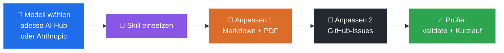
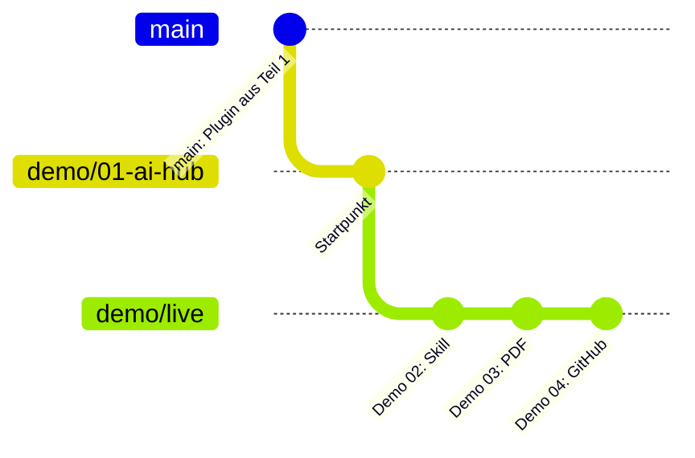
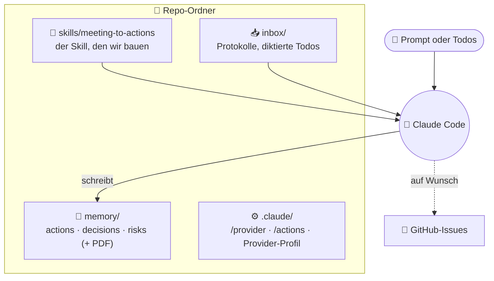
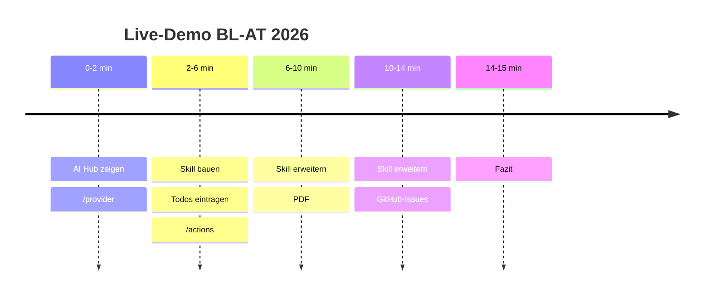

# 00 · Worum geht es? (visuell)

## Die Idee in einem Bild

Wir behalten den Agenten aus Teil 1 und zeigen, wie man seinen wichtigsten Baustein, den **Skill**, einsetzt und mit kleinen Änderungen erweitert. Den Motor (das Modell) können wir dabei frei wählen.

## Ein Ordner, ein Branch, vier Schritte

Live gebaut wird auf einem Branch `demo/live`. Die fertigen Stände der Schritte liegen als Referenz in eigenen Branches bereit.

## Der Arbeitsplatz

Alles passiert im Repo-Ordner. Eingaben landen in `inbox/`, Ergebnisse in `memory/`. Beide Ordner sind von Git ausgeschlossen.

## Ablauf über 15 Minuten

## Kernaussage

> **Ein Skill ist eine Anleitung, die man wie Code behandelt.** Ein paar Zeilen mehr, und aus Markdown-Notizen werden PDF-Berichte und GitHub-Issues. Validieren und kurz prüfen gehört dazu.
