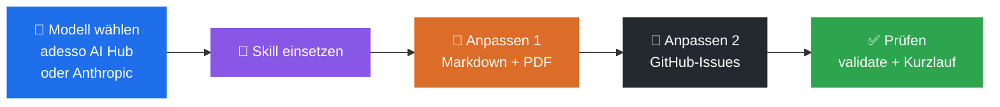
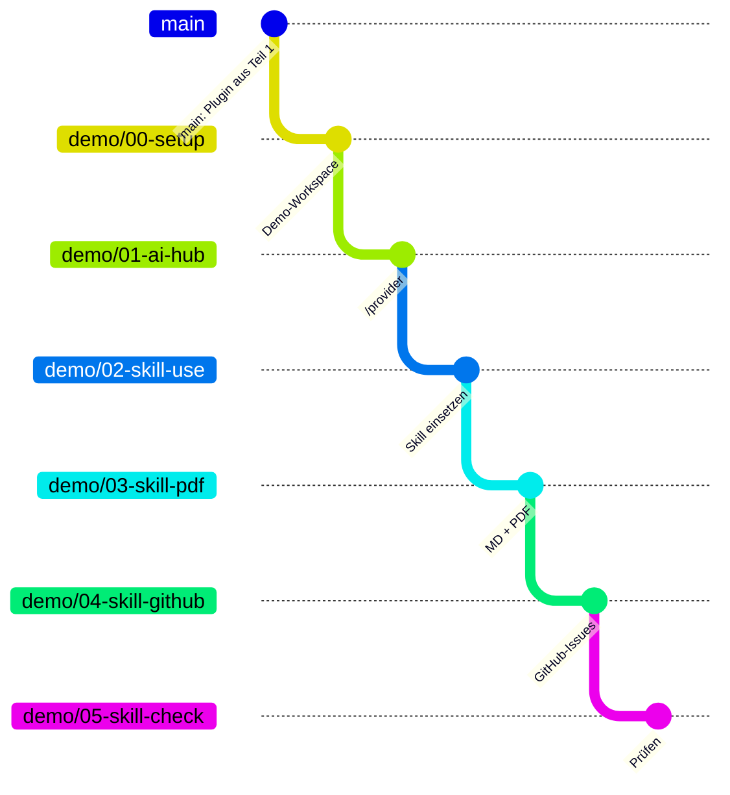
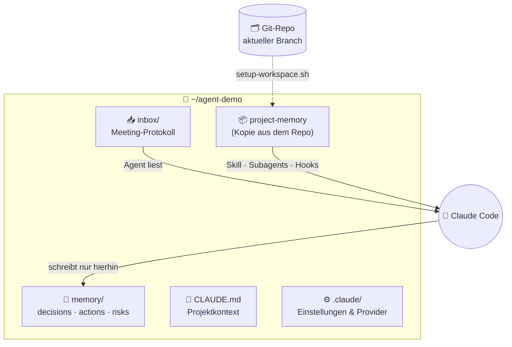
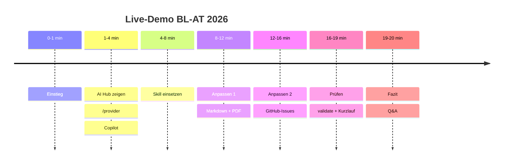

# 00 · Worum geht es? (visuell)

## Die Idee in einem Bild

Wir behalten den Agenten aus Teil 1 und zeigen, wie man seinen wichtigsten Baustein, den **Skill**, einsetzt und mit kleinen Änderungen erweitert. Den Motor (das Modell) können wir dabei frei wählen.

## Sechs Branches, eine Treppe

Jede Stufe baut auf der vorherigen auf. Klappt live etwas nicht, nehmen wir einfach die nächste Stufe.

## Der Demo-Arbeitsplatz

Ein Ordner auf dem Laptop. Das Setup-Skript kopiert das Plugin des aktuellen Git-Branches hinein, so ist jeder Demo-Schritt mit einem Befehl hergestellt.

## Ablauf über 20 Minuten

## Kernaussage

> **Ein Skill ist eine Anleitung, die man wie Code behandelt.** Ein paar Zeilen mehr, und aus Markdown-Notizen werden PDF-Berichte und GitHub-Issues. Validieren und kurz prüfen gehört dazu.
