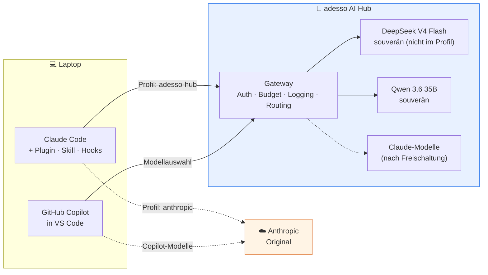
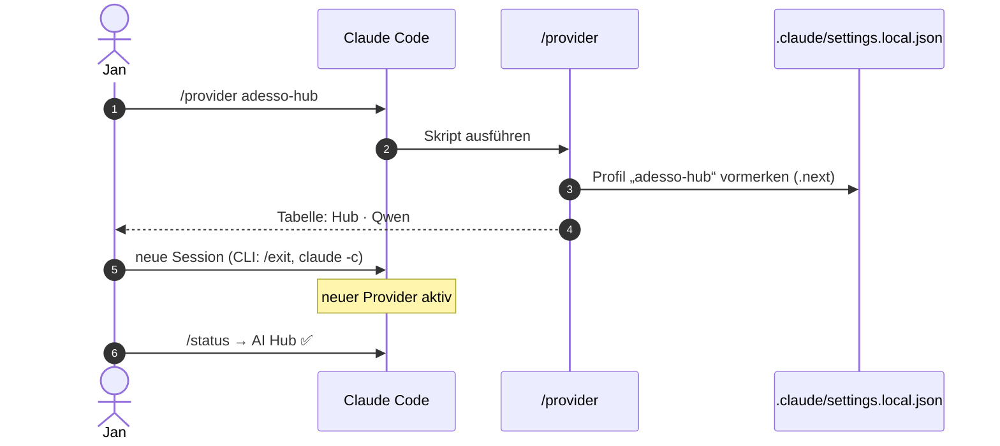
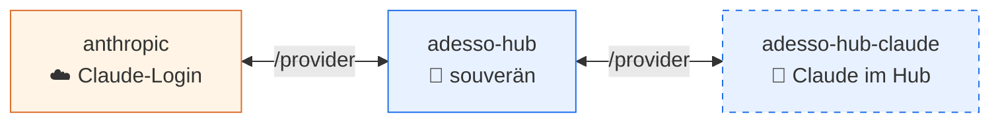
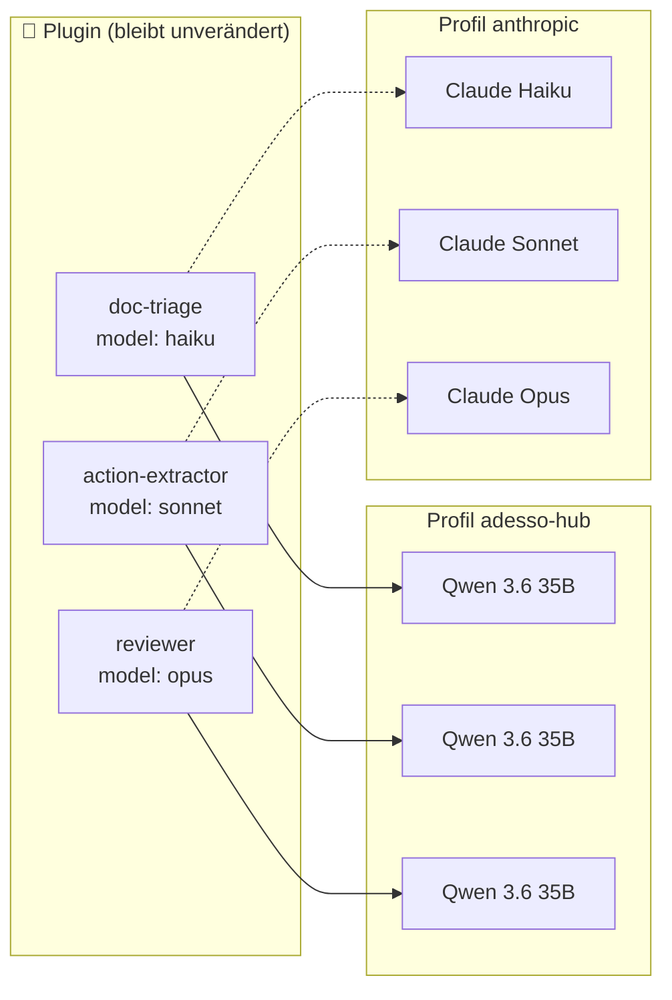
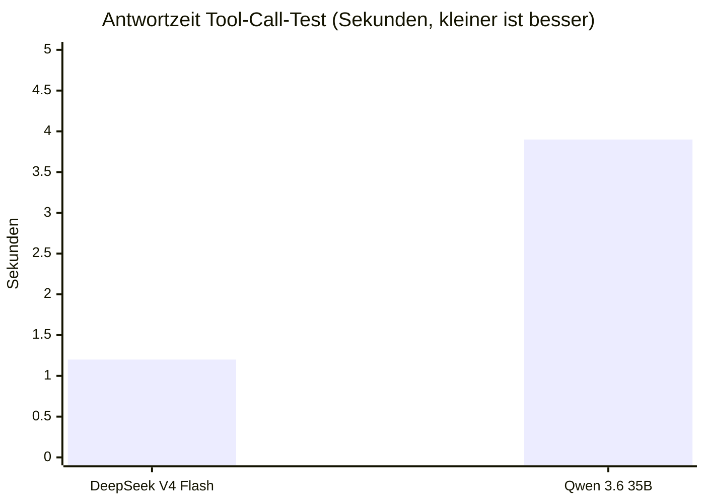
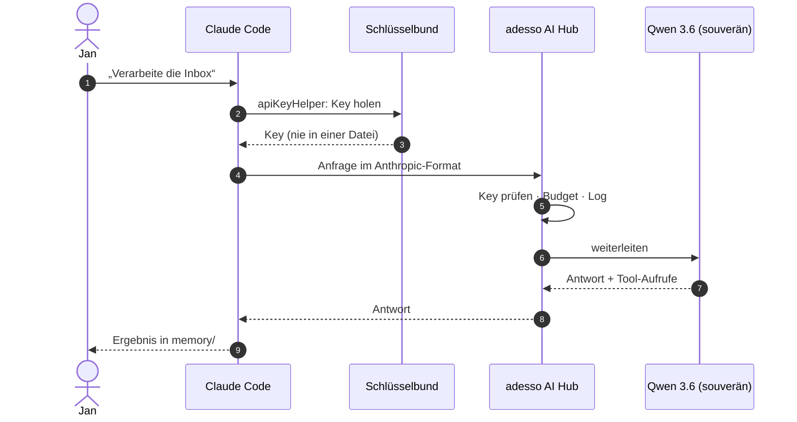

# 01 · Gleicher Agent, anderer Motor (visuell)

## Die Idee

Claude Code ist das Auto, das Modell ist der Motor. Mit dem adesso AI Hub tauschen wir den Motor gegen einen souveränen, ohne am Auto etwas zu ändern.

## Ein Befehl zum Umschalten, direkt in Claude Code

> Warum eine neue Session? Adresse und Key gelten pro Sitzung. In VS Code einfach eine neue Session öffnen. In der CLI `/exit` und `claude -c`, dann läuft das Gespräch weiter.

## Drei Namen, beliebige Modelle

Das Plugin kennt nur die Rollen-Namen `opus`, `sonnet`, `haiku`. Das Profil entscheidet, welches echte Modell antwortet.

## Erst messen, dann einsetzen

Bevor ein Modell in den Agenten darf, prüfen wir: Ist es erreichbar, ist es schnell, ruft es Werkzeuge richtig auf?

| Modell | erreichbar | Tool-Call korrekt | Rolle |
|---|---|---|---|
| DeepSeek V4 Flash | ✅ API · ⚠️ in Claude Code unzuverlässig | ✅ | nicht im Profil |
| Qwen 3.6 35B | ✅ | ✅ | alle Rollen (opus · sonnet · haiku) |
| Claude über den Hub | ⛔ noch nicht freigeschaltet | – | später Vergleich |

## Was bei einer Anfrage passiert

## Kernaussage

> **Ein Befehl hin, ein Befehl zurück.** Plugin, Skill und Hooks bleiben gleich, nur der Motor wechselt. Wir zeigen den Hub und arbeiten danach mit den Original-Claude-Modellen weiter.
