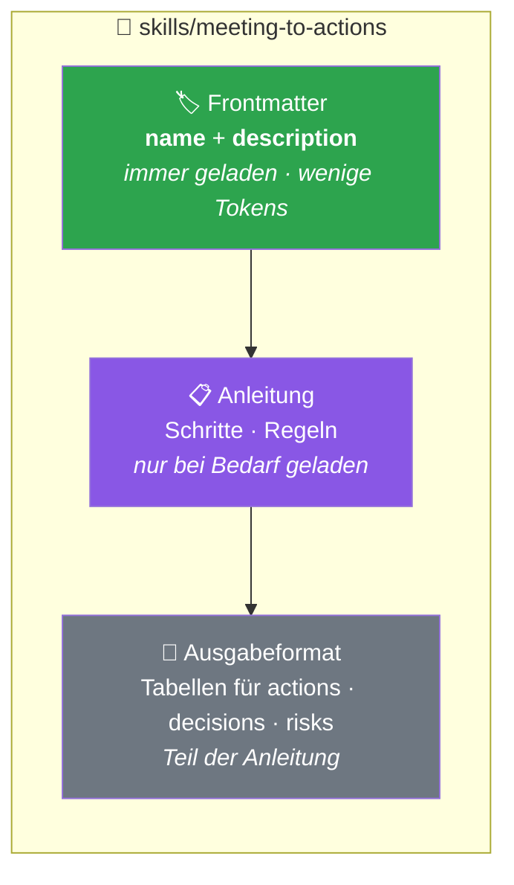
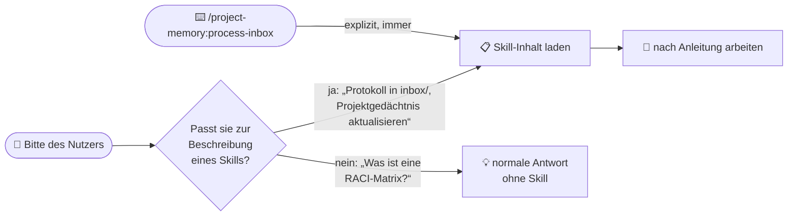
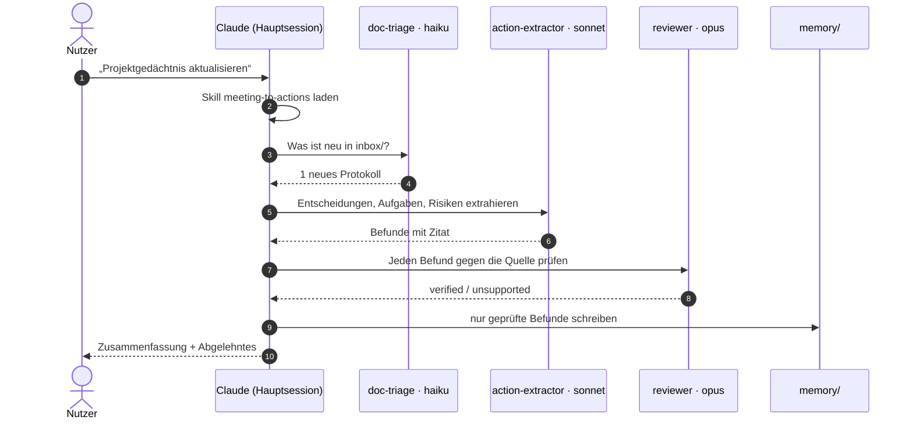
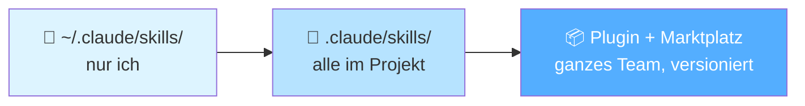
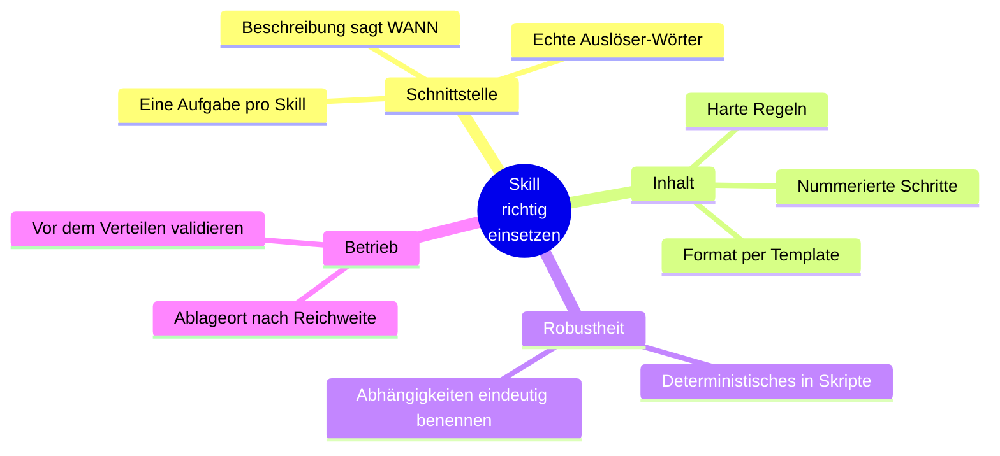

# 02 · Wie ein Skill arbeitet (visuell)

## Ein Skill ist eine Anleitung mit Schnittstelle

> **Progressive Disclosure:** Claude kennt von jedem Skill nur das Etikett. Den Inhalt liest er erst, wenn das Etikett zur Aufgabe passt. So kann man viele Skills haben, ohne den Kontext zu verstopfen.

## Wann löst ein Skill aus?

## Was der Skill im Projekt anstößt

## Wo ein Skill liegt, bestimmt, wer ihn hat

## Acht Regeln auf einen Blick

## Kernaussage

> **Die Beschreibung ist die Schnittstelle, die Anleitung die Implementierung.** Weil der Skill nur eine Anleitung ist, lässt er sich mit ein paar Zeilen erweitern. Das machen wir als Nächstes.
