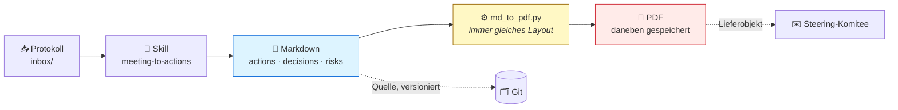
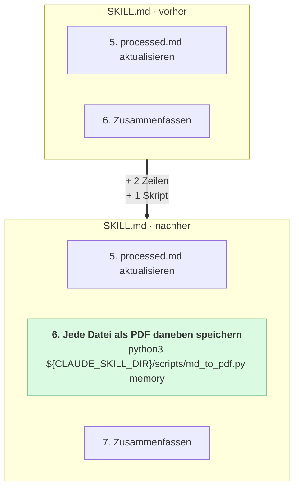
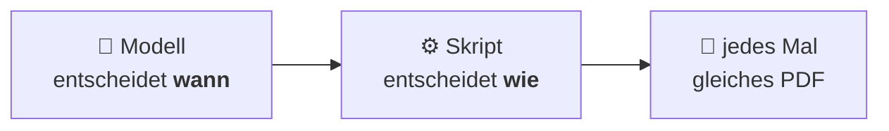
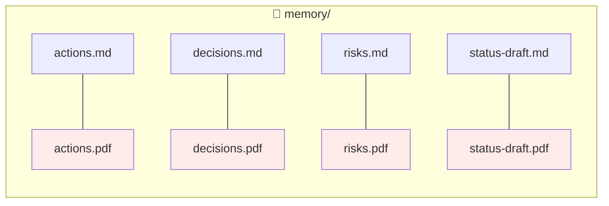
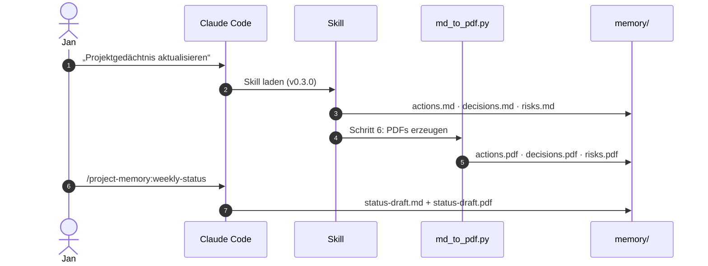

# 03 · Aus Notizen werden Dokumente (visuell)

## Die Idee

Der Skill schreibt seine Ergebnisse wie bisher als Markdown. Mit einer kleinen Anpassung legt er jedes Ergebnis zusätzlich als PDF daneben, fertig zum Verschicken.

## Die ganze Änderung: zwei Zeilen

## Wer macht was?

> **Faustregel:** Was immer gleich aussehen muss (Layout, Format, Berechnung), gehört in ein Skript. Das Modell ruft es nur auf.

## Was am Ende in `memory/` liegt

## Ablauf live

## Kernaussage

> **Ein Skill ist eine Anleitung, also lässt er sich wie eine Anleitung erweitern.** Zwei Zeilen plus ein Skript, und aus Notizen werden verschickbare Dokumente.
