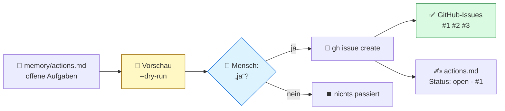
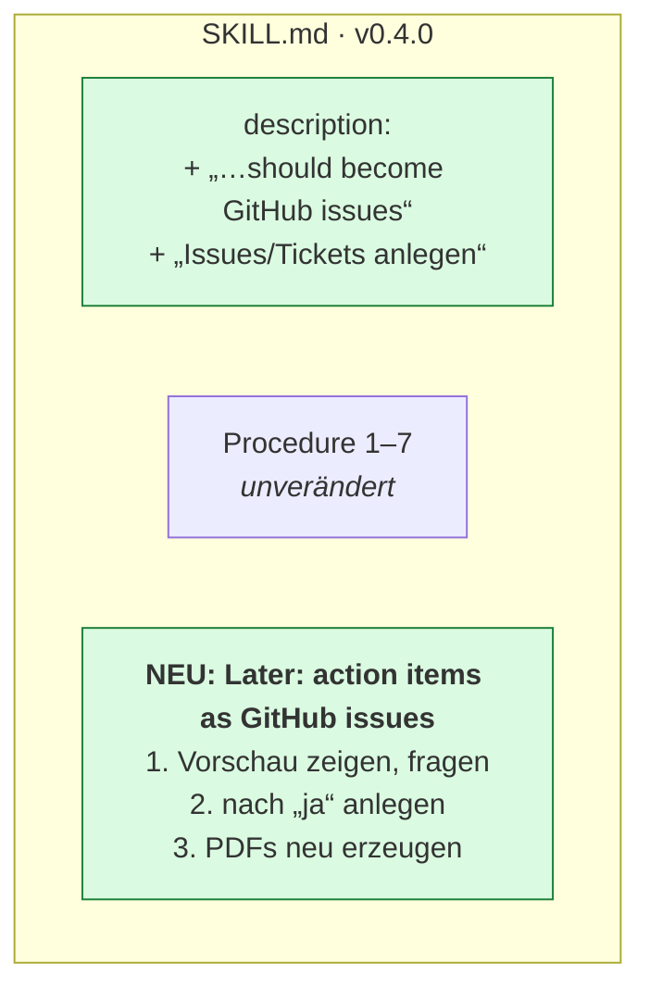
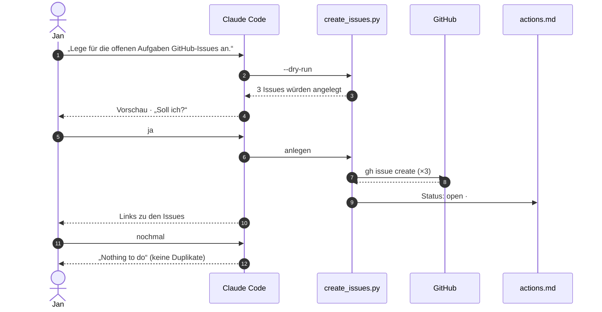
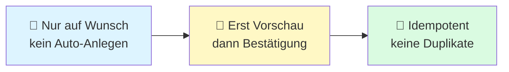
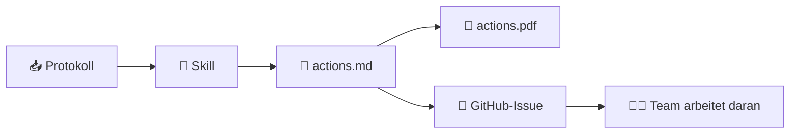

# 04 · Von der Notiz ins Ticketsystem (visuell)

## Die Idee

Aufgaben aus dem Meeting landen nicht nur in einer Datei, sondern auf Wunsch als Issues in GitHub. Ein Mensch bestätigt, bevor etwas angelegt wird.

## Die Änderung im Skill

> Die Beschreibung bekommt neue Auslöser, damit der Skill bei „Tickets anlegen“ anspringt. Der neue Abschnitt sagt, *wie*.

## Ablauf live

## Drei Sicherheitsgurte

## Der ganze Weg einer Aufgabe

## Kernaussage

> **Ein paar Zeilen im Skill, und der Agent reicht Arbeit ins Ticketsystem weiter, mit Vorschau, Bestätigung und ohne Duplikate.**
