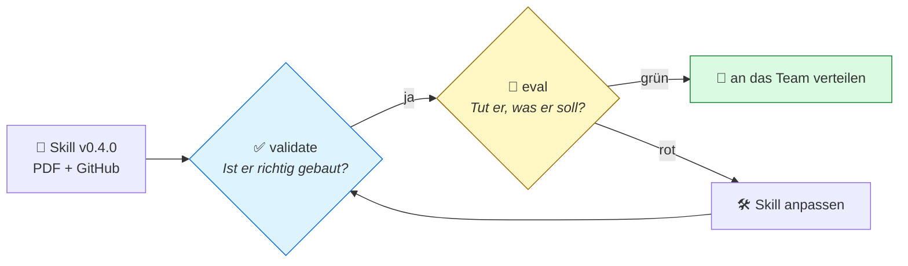
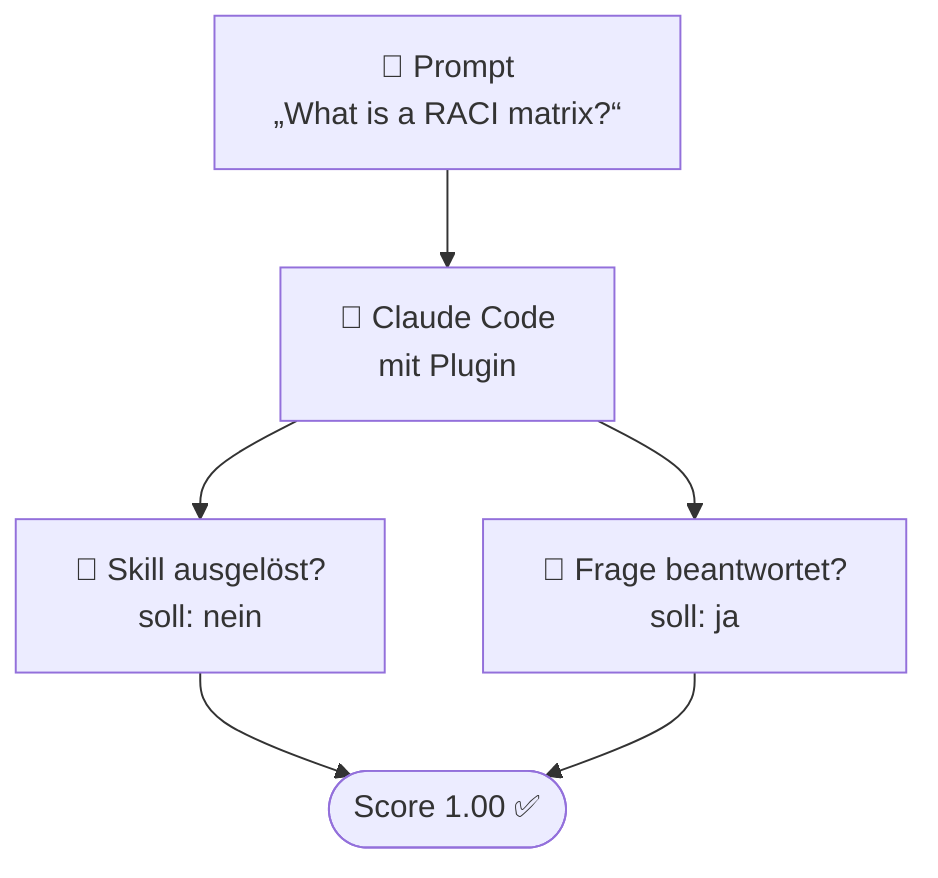
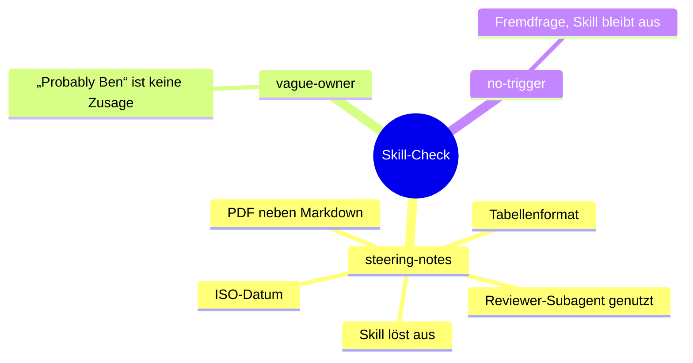
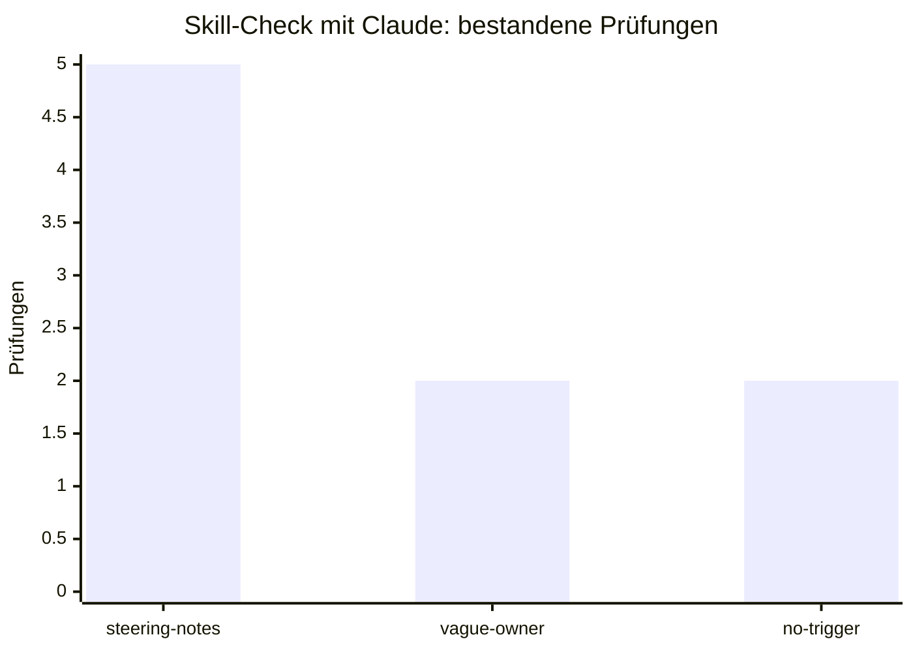
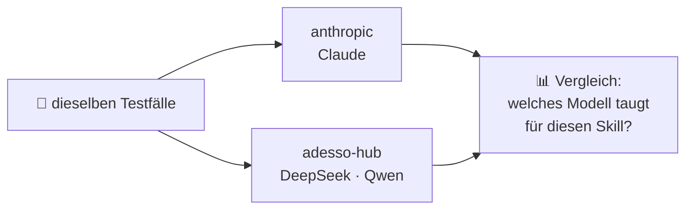

# 05 · Prüfen gehört dazu (visuell)

## Zwei Fragen, zwei Werkzeuge

> **validate** = Linter: schnell, prüft nur die Form.
> **eval** = Test: lässt den Agenten echte Aufgaben lösen und prüft das Ergebnis.

## Ein Testfall auf einen Blick

## Was der volle Check prüft

## Ergebnis der Generalprobe

**9 von 9 Prüfungen bestanden** · kurzer Lauf in Sekunden, voller Lauf ca. 2,5 Minuten.

## Gleicher Test, anderes Modell

## Kernaussage

> **Jede Skill-Änderung bekommt einen kurzen Prüflauf.** So bleibt ein Skill verlässlich, auch wenn er wächst oder das Modell wechselt.
